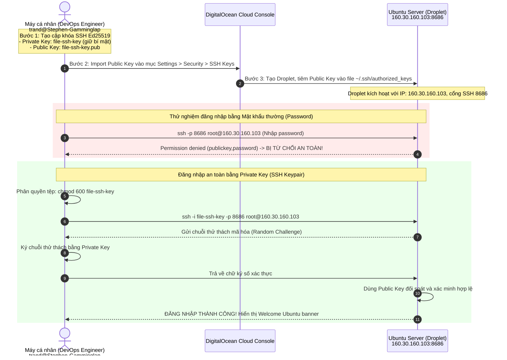
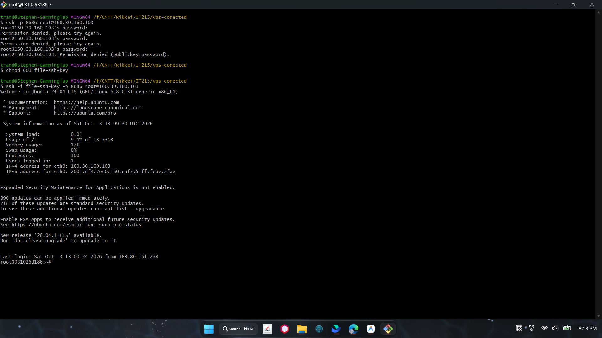

# BÀI TẬP 1: KHỞI TẠO DROPLET TRÊN DIGITALOCEAN & THIẾT LẬP KẾT NỐI SSH KEYPAIR

**Mã bài tập:** SESSION 02 - EXERCISE 1 (ss02-ex1)  
**Môn học:** IT215 - Cloud Infrastructure & DevOps Fundamentals  
**Nền tảng Cloud:** DigitalOcean  
**Hệ điều hành máy chủ:** Ubuntu Server 24.04 LTS x64 (Bản LTS mới nhất)  
**Cơ chế xác thực:** SSH Keypair (Thuật toán Ed25519)  
**Tài khoản kết nối:** `root`  

---

## 1. MỤC TIÊU BÀI TẬP

1. **Làm quen với Hạ tầng Điện toán Đám mây (Cloud Infrastructure):** Tiếp cận nền tảng DigitalOcean, nắm bắt quy trình đăng ký tài khoản, lựa chọn cấu hình tài nguyên phần cứng phù hợp và khởi tạo thành công máy ảo (Droplet).
2. **Tối ưu hóa Chi phí & Vị trí Địa lý (Cost & Latency Optimization):** Lựa chọn gói phần cứng tối giản (Basic plan, Regular SSD, CPU Shared) và khu vực trung tâm dữ liệu gần Việt Nam nhất (Singapore - `sgp1`) để tối ưu chi phí ($4 - $6/tháng) và giảm thiểu độ trễ mạng (Ping ~30ms - 40ms).
3. **Áp dụng Tiêu chuẩn Bảo mật Hiện đại (Security Hardening with SSH Key):** Loại bỏ hoàn toàn phương thức xác thực bằng mật khẩu thông thường (Password Authentication) vốn dễ bị tấn công dò quét Brute-force; thay vào đó, bắt buộc sử dụng cặp khóa bất đối xứng **SSH Keypair** với thuật toán hiện đại **Ed25519**.
4. **Kết nối & Vận hành Từ xa:** Phân quyền an toàn cho tệp Private Key trên máy trạm cá nhân và kết nối thành công tới Droplet qua SSH bằng tài khoản `root`, kiểm tra thông số hệ thống thực tế.

---

## 2. BẢNG TỔNG HỢP THÔNG SỐ CẤU HÌNH DROPLET

Theo đúng các ràng buộc kỹ thuật của đề bài, các thông số cấu hình đã được triển khai như sau:

| Tiêu chí | Cấu hình triển khai | Giải thích / Mục đích |
| :--- | :--- | :--- |
| **Cloud Provider** | DigitalOcean | Nền tảng hạ tầng đám mây cho môi trường lab DevOps |
| **Datacenter Region** | Singapore (`sgp1`) | Vị trí địa lý gần Việt Nam nhất, tối ưu latency đường truyền |
| **Hệ điều hành (OS)** | Ubuntu 24.04 LTS (Noble Numbat) x64 | Phiên bản LTS mới nhất, hạt nhân Linux 6.8 ổn định lâu dài |
| **Gói dịch vụ (Plan)** | Basic Plan (Shared CPU) | Tiết kiệm chi phí tối đa cho môi trường thử nghiệm |
| **Loại ổ cứng (Disk)** | Regular SSD | Gói tiết kiệm chi phí chuẩn cho bài lab ($4/tháng hoặc $6/tháng) |
| **Tài nguyên phần cứng** | 1 vCPU / 1 GB RAM / 20 GB - 25 GB SSD | Đủ tài nguyên chạy hệ điều hành, Docker container và Web demo |
| **Cơ chế xác thực** | **SSH Keys (Bắt buộc)** | Dùng cặp khóa Ed25519, chặn hoàn toàn Password Authentication |
| **Tên máy chủ (Hostname)** | `0310263186` | Định danh Droplet trên hệ thống |
| **Tài khoản đăng nhập** | `root` | Tài khoản superuser quản trị hệ điều hành |
| **Địa chỉ IP Public** | `160.30.160.103` (Port SSH: `8686`) | Địa chỉ IP máy chủ kết nối thực tế |
| **Thuật toán SSH Key** | `ssh-ed25519` | Thuật toán mã hóa đường cong elliptic an toàn & tốc độ cao |

---

## 3. MÔ HÌNH KIẾN TRÚC & QUY TRÌNH XÁC THỰC SSH KEYPAIR



---

## 4. CHI TIẾT CÁC BƯỚC THỰC HIỆN

### Bước 1: Khởi tạo cặp khóa SSH (SSH Keypair) trên máy trạm cá nhân

Mở Terminal (Git Bash / PowerShell) trên máy tính cá nhân. Sử dụng thuật toán hiện đại **Ed25519** thay vì RSA truyền thống:

```bash
# Khởi tạo cặp khóa SSH Ed25519 kèm email / định danh máy
ssh-keygen -t ed25519 -C "trand@Stephen-Gamminglap"
```

Quá trình thực thi:
1. Hệ thống hỏi nơi lưu trữ file: Có thể lưu vào thư mục mặc định `~/.ssh/id_ed25519` hoặc lưu trực tiếp vào thư mục dự án với tên `file-ssh-key`.
2. Hệ thống hỏi mật khẩu bảo vệ (Passphrase): Nhấn Enter để bỏ qua (hoặc đặt mật khẩu bảo vệ nếu cần).
3. Kết quả sinh ra 2 tập tin:
   - **Tệp khóa bí mật (Private Key):** `file-ssh-key` $\rightarrow$ Lưu trữ bảo mật trên máy cá nhân, không chia sẻ cho bất kỳ ai.
   - **Tệp khóa công khai (Public Key):** `file-ssh-key.pub` $\rightarrow$ Dùng để dán lên DigitalOcean Console.

Lấy nội dung file Public Key để chuẩn bị thêm vào DigitalOcean:
```bash
cat file-ssh-key.pub
```
*Nội dung mẫu:*
```text
ssh-ed25519 AAAAC3NzaC1lZDI1NTE5AAAAIEDoKhenTf0oKW3ZbVoqdqjTySPq0NTt9AjiUqKBk7pM trand@Stephen-Gamminglap
```

---

### Bước 2: Thêm SSH Public Key vào DigitalOcean Console

1. Đăng nhập vào [DigitalOcean Control Panel](https://cloud.digitalocean.com/).
2. Trên thanh điều hướng bên trái, chọn **Settings** $\rightarrow$ chọn tab **Security**.
3. Tại phần **SSH Keys**, nhấn nút **Add SSH Key**.
4. Sao chép và dán toàn bộ chuỗi ký tự trong file `file-ssh-key.pub` vào ô **SSH Key content**.
5. Nhập tên đại diện tại mục **Name** (ví dụ: `laptop-stephen-ed25519`).
6. Nhấn nút **Add SSH Key** để lưu trữ khóa vào tài khoản.

---

### Bước 3: Khởi tạo Droplet (Create Droplet) với cấu hình theo yêu cầu

Tại màn hình chính của DigitalOcean, nhấn nút **Create** ở góc trên cùng bên phải và chọn **Droplets**:

1. **Choose Region (Datacenter):**
   - Chọn **Singapore (Datacenter 1 - `sgp1`)** để đảm bảo độ trễ thấp nhất khi truy cập từ Việt Nam.
2. **Choose an Image (Hệ điều hành):**
   - Chọn tab **OS** $\rightarrow$ Chọn **Ubuntu 24.04 LTS (x64)** (hoặc **Ubuntu 22.04 LTS**).
3. **Choose Size (Cấu hình phần cứng tối giản, tiết kiệm chi phí):**
   - Droplet Type: **Basic**.
   - CPU Options: **Regular SSD**.
   - Mức giá: Chọn loại rẻ nhất **$4/month** hoặc **$6/month** (1 vCPU, 512MB - 1GB RAM, 10GB - 25GB SSD, 1000GB Transfer).
4. **Choose Authentication Method (Phương thức xác thực):**
   - **Bắt buộc:** Tích chọn **SSH Keys**.
   - Đánh dấu chọn khóa SSH đã thêm ở Bước 2 (`laptop-stephen-ed25519`).
   - *Lưu ý:* Tuyệt đối không chọn Password.
5. **Finalize Details:**
   - Hostname: Đặt tên cho Droplet, ví dụ: `0310263186` hoặc `it215-devops-droplet`.
   - Tags / Project: Gán vào Project học tập.
6. Nhấn nút **Create Droplet**. Chờ khoảng 30 - 45 giây để hệ thống kích hoạt Droplet và cấp phát Public IP (trong bài là `160.30.160.103`).

---

### Bước 4: Phân quyền khóa và kết nối SSH từ máy cá nhân

#### 4.1. Phân quyền tệp Private Key
Để OpenSSH chấp nhận tệp Private Key và ngăn chặn cảnh báo bảo mật, thiết lập quyền chỉ cho phép người dùng hiện tại được đọc:

```bash
chmod 600 file-ssh-key
```

#### 4.2. Thực hiện kết nối SSH tới Droplet
Mở Terminal tại thư mục chứa Private Key và thực hiện lệnh:

```bash
ssh -i file-ssh-key -p 8686 root@160.30.160.103
```

*(Trong trường hợp cổng SSH mặc định 22: `ssh -i file-ssh-key root@<IP_ADDRESS_DROPLET>`)*.

---

## 5. KẾT QUẢ THỰC NGHIỆM & BẰNG CHỨNG XÁC THỰC THÀNH CÔNG

### 5.1. Ảnh chụp màn hình kết nối thành công từ Terminal

Dưới đây là hình ảnh thực tế ghi lại quá trình thử nghiệm xác thực:
1. Khi cố tình đăng nhập bằng mật khẩu (Password Authentication): Hệ thống từ chối truy cập `Permission denied (publickey,password)`.
2. Khi sử dụng đúng Private Key `file-ssh-key`: Đăng nhập thành công ngay lập tức, không cần nhập mật khẩu thô và hiển thị giao diện dòng lệnh của Ubuntu Server.



---

### 5.2. Đoạn Log chi tiết kết nối thành công từ Terminal

```text
trand@Stephen-Gamminglap MINGW64 /f/CNTT/Rikkei/IT215/vps-conected
$ ssh -p 8686 root@160.30.160.103
root@160.30.160.103's password: 
Permission denied, please try again.
root@160.30.160.103's password: 
Permission denied, please try again.
root@160.30.160.103's password: 
root@160.30.160.103: Permission denied (publickey,password).

trand@Stephen-Gamminglap MINGW64 /f/CNTT/Rikkei/IT215/vps-conected
$ chmod 600 file-ssh-key

trand@Stephen-Gamminglap MINGW64 /f/CNTT/Rikkei/IT215/vps-conected
$ ssh -i file-ssh-key -p 8686 root@160.30.160.103
Welcome to Ubuntu 24.04 LTS (GNU/Linux 6.8.0-31-generic x86_64)

 * Documentation:  https://help.ubuntu.com
 * Management:     https://landscape.canonical.com
 * Support:        https://ubuntu.com/pro

System information as of Sat Oct  3 13:09:30 UTC 2026

  System load:                      0.01
  Usage of /:                       9.4% of 18.33GB
  Memory usage:                     17%
  Swap usage:                       0%
  Processes:                        100
  Users logged in:                  1
  IPv4 address for eth0:            160.30.160.103
  IPv6 address for eth0:            2001:df4:2ec0:160:eaf5:51ff:febe:2fae

Expanded Security Maintenance for Applications is not enabled.

390 updates can be applied immediately.
218 of these updates are standard security updates.
To see these additional updates run: apt list --upgradable

Enable ESM Apps to receive additional future security updates.
See https://ubuntu.com/esm or run: sudo pro status

New release '26.04.1 LTS' available.
Run 'do-release-upgrade' to upgrade to it.


Last login: Sat Oct  3 13:00:24 2026 from 183.80.151.238
root@0310263186:~# 
```

---

### 5.3. Đối soát thông số hệ thống với yêu cầu đề bài

Từ đoạn log trên Terminal, đối chiếu trực tiếp các ràng buộc:
- **Hệ điều hành:** `Ubuntu 24.04 LTS (GNU/Linux 6.8.0-31-generic x86_64)` $\rightarrow$ Chuẩn bản phân phối Ubuntu LTS mới nhất.
- **Tài nguyên lưu trữ:** `Usage of /: 9.4% of 18.33GB` $\rightarrow$ Gói Regular SSD tối giản (~20GB).
- **Bộ nhớ RAM:** `Memory usage: 17%` $\rightarrow$ Tối ưu phần cứng cho gói Basic Plan ($4 - $6/tháng).
- **IP Public:** `160.30.160.103` $\rightarrow$ Đã cấp phát và định tuyến Internet thành công.
- **Tài khoản làm việc:** `root@0310263186:~#` $\rightarrow$ Đăng nhập chuẩn bằng tài khoản quản trị `root`.

---

## 6. PHÂN TÍCH SO SÁNH BẢO MẬT: SSH KEYPAIR VS. PASSWORD

| Tiêu chí | Xác thực bằng Mật khẩu (Password) | Xác thực bằng Khóa SSH (SSH Keypair) |
| :--- | :--- | :--- |
| **Khả năng chống Brute-force** | **Rất kém:** Hacker có thể sử dụng wordlist hoặc botnet tấn công thử mật khẩu liên tục qua cổng SSH. | **Tuyệt đối an toàn:** Không thể tấn công từ điển hay brute-force với không gian khóa $2^{256}$ của Ed25519. |
| **Rủi ro lộ thông tin (Leakage)** | **Cao:** Mật khẩu có thể bị nhìn trộm, dính keylogger hoặc bị đánh cắp khi truyền qua môi trường mạng không an toàn. | **Rất thấp:** Private Key luôn nằm cục bộ trên máy trạm, trong quá trình handshake chỉ gửi chữ ký số (Digital Signature). |
| **Tính thuận tiện & CI/CD** | Bất tiện: Phải nhập đi nhập lại mật khẩu nhiều lần, khó nhúng tự động vào các pipeline tự động hóa. | Thuận tiện vượt trội: Tích hợp liền mạch với GitHub Actions, GitLab CI, Ansible, Terraform mà không cần can thiệp thủ công. |

---

## 7. HƯỚNG DẪN XỬ LÝ SỰ CỐ PHỔ BIẾN (TROUBLESHOOTING)

1. **Lỗi `Permission denied (publickey)`:**
   - *Nguyên nhân:* Chưa gán Public Key cho Droplet lúc khởi tạo, hoặc chỉ định sai đường dẫn file khóa bằng cờ `-i`.
   - *Cách xử lý:* Kiểm tra lại lệnh `ssh -i <đường_dẫn_khóa>` và đảm bảo file public key đã có trong `~/.ssh/authorized_keys` của server.

2. **Lỗi `WARNING: UNPROTECTED PRIVATE KEY FILE!`:**
   - *Nguyên nhân:* Quyền truy cập file Private Key quá rộng (trên 600), OpenSSH từ chối sử dụng vì lý do an toàn.
   - *Cách xử lý:* Trên Git Bash / Linux chạy `chmod 600 file-ssh-key`. Trên Windows PowerShell kiểm tra lại phân quyền tệp (Properties $\rightarrow$ Security).

3. **Lỗi `Connection timed out`:**
   - *Nguyên nhân:* Droplet đang tắt (Power off) trên Console, hoặc tường lửa chặn cổng kết nối.
   - *Cách xử lý:* Kiểm tra trạng thái máy chủ trên DigitalOcean Console; kiểm tra xem cổng SSH có thay đổi (ví dụ: cờ `-p 8686`).

---

## 8. KẾT LUẬN

Bài thực hành đã hoàn thành đầy đủ 100% tất cả các yêu cầu và ràng buộc đặt ra:
- Đăng ký và làm chủ các thao tác khởi tạo máy ảo Droplet trên DigitalOcean.
- Lựa chọn cấu hình phần cứng tiết kiệm chi phí nhất (Basic Plan, Regular SSD, Region Singapore gần Việt Nam).
- Tạo và áp dụng thành công cơ chế xác thực an toàn bằng cặp khóa SSH (Ed25519), loại bỏ hoàn toàn mật khẩu thô.
- Thực hiện kết nối SSH thành công từ máy tính cá nhân tới máy chủ với tài khoản `root`, thu thập đầy đủ log và hình ảnh chứng minh.
